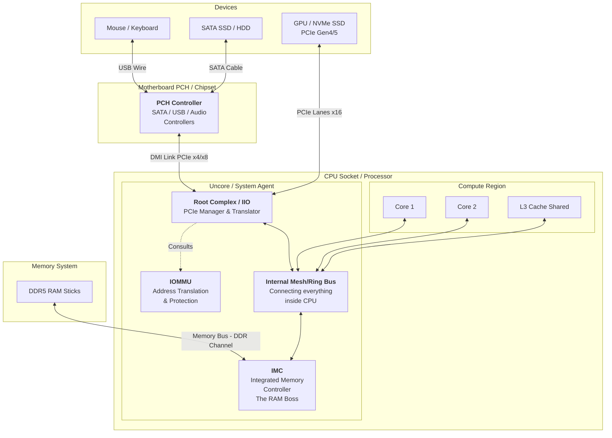

# PCIe DMA Data Path

## System Overview

## Integrated Memory Controller (IMC)

The Integrated Memory Controller (IMC) is a crucial component found directly on modern CPUs and Systems-on-a-Chip (SoCs). Its primary role is to manage the flow of data between the processor and the system's main memory (DRAM).

By placing the memory controller on the CPU die, the IMC eliminates the need for a separate "northbridge" chip, a legacy design that often created performance bottlenecks. This direct integration leads to significantly lower latency and higher memory bandwidth.

Every operation that reaches DRAM, whether initiated by the CPU or by a peripheral device via the Root Complex, is handled by the IMC. Note that not every access reaches DRAM immediately: caches can absorb it first (see [Cache involvement](#cache-involvement-ddio)).

### Key Responsibilities

- **Scheduling:** Determines the optimal timing and order for memory read and write operations.
- **Address Mapping:** Translates the CPU's memory requests into the specific row, column, and bank addresses required by the DRAM chips.
- **Memory Refresh:** Periodically refreshes the data stored in DRAM to prevent data loss.
- **Multi Channel Interleaving:** Distributes memory access across multiple memory channels to increase throughput.

## Root Complex (IIO)

The Root Complex is the root of the PCIe tree hierarchy and the bridge between the CPU, main memory, and the PCIe devices. All PCIe devices are connected to it, either directly or through switches.

On modern CPUs, the Root Complex is integrated directly onto the processor die. Intel calls this Integrated I/O (IIO). This integration provides a high-bandwidth, low-latency path for I/O devices to communicate with the CPU and memory.

The Root Complex is responsible for several critical functions:

- **Transaction Generation:** It initiates PCIe transactions (e.g., memory reads/writes) on behalf of the CPU to communicate with PCIe endpoints.
- **Traffic Arbitration:** PCIe is point-to-point, so there is no shared bus to win. Instead, the Root Complex arbitrates between CPU-originated and device-originated requests competing for its internal resources and ports.
- **Address Space Management:** It forwards device memory requests (DMA) into the system address space and CPU accesses to device memory (MMIO) out to the right PCIe port.
- **Configuration Access:** It provides the mechanism (e.g., ECAM, memory-mapped configuration space) through which software reads and writes each device's configuration space. Enumeration itself, meaning discovering devices, building the hierarchy and assigning memory ranges and interrupts, is carried out by firmware and the OS.
- **Interrupt Delivery:** MSI/MSI-X interrupts are ordinary memory writes to an address in the interrupt controller's range, which the Root Complex forwards to the target core's local APIC. Legacy INTx interrupts are carried as in-band messages and converted to the system's interrupt controller.
- **Error Reporting:** It collects and reports errors that occur on the PCIe fabric, which is essential for system reliability and diagnostics.

## Data Flow Scenarios

### Scenario A: A High-Speed PCIe Device (NVMe SSD / GPU) Writes to Memory

The direct path: the device is attached straight to the CPU's PCIe lanes.

1. **The Request: TLP from the Device**
   An NVMe SSD (or a GPU) wants to write data into system memory.
   It sends a PCIe Memory Write Transaction Layer Packet (TLP) containing the target address and the data payload.

2. **The Path: Over the PCIe Lanes**
   The TLP travels over the PCIe lanes from the endpoint to the CPU package.
   When the device is attached directly to the CPU there are no extra hubs or bridges in the middle. If it sits behind a PCIe switch, the TLP passes through that first.

3. **The Gate: Root Complex + IOMMU**
   The packet enters the Root Complex integrated into the CPU.
   If the IOMMU is enabled, the Root Complex consults it. The address in the TLP is an I/O virtual address (IOVA); the IOMMU translates it to a physical address and checks that this device is allowed to access it (DMA remapping / protection). Without an IOMMU, the address is used as a physical address as-is.

4. **The Internal Fabric: Mesh / Ring**
   Once the access is approved, the Root Complex forwards the write request onto the CPU's internal interconnect (Mesh or Ring bus), which connects all cores, caches, and the IMC.

5. **The Destination: Cache or IMC**
   On platforms with Intel DDIO (see below) the write is typically placed into the shared L3 cache. Otherwise, or when the line is later evicted, the request reaches the IMC, which translates the system address into DRAM row/column/bank and schedules the write.

6. **The Execution: Write to DRAM**
   The IMC performs the actual write to the DRAM chips. The data is now stored in RAM.

7. **Important Note: DMA, Not CPU-Driven Copies**
   The CPU cores themselves are not involved in moving the data.
   The transfer is done via Direct Memory Access (DMA): the device writes directly to memory through the Root Complex, IOMMU, and IMC.

### Scenario B: A Chipset-Attached SATA (or USB) Drive Writes to Memory

A longer path that goes through the chipset (PCH).

1. **The Request: SATA/USB Transfer on the Cable**
   A SATA drive (or USB storage device) wants to write data.
   It sends the data over the SATA (or USB) cable to the motherboard.

2. **First Stop: PCH / Chipset Controller**
   The data arrives at the Platform Controller Hub (PCH) on the motherboard.
   Inside the PCH, the SATA (AHCI) or USB (xHCI) controller receives the data and buffers it. These controllers are themselves PCIe functions and act as the DMA bus masters.

3. **The Bridge: DMI Link to the CPU**
   The controller issues its DMA as PCIe-style transactions, which travel to the CPU over the DMI link.
   DMI is essentially a dedicated PCIe-based link between the chipset and the CPU.

4. **Entering the CPU: Seen as PCIe Traffic**
   On the CPU side, these transactions arrive at the Root Complex.
   From the Root Complex's point of view, the PCH controllers are just PCIe devices performing DMA.

5. **From Here On: Same as Scenario A**
   From this point, the flow is identical to the high-speed device path:
   - Root Complex (with IOMMU translation)
   - Internal Mesh/Ring interconnect
   - L3 cache or IMC (Integrated Memory Controller)
   - DRAM (RAM) write

6. **Result: Longer, Narrower Path**
   Functionally the result is the same: data ends up in RAM via DMA.
   However, the path is longer and typically has lower bandwidth and higher latency than a direct PCIe endpoint (like NVMe or a GPU), because it goes through the PCH and the DMI link.

## Cache involvement (DDIO)

On many Intel Xeon platforms, Data Direct I/O (DDIO) lets inbound DMA writes land directly in a portion of the shared L3 cache instead of going to DRAM first, so a CPU core that reads the data soon after finds it in cache. The data reaches DRAM only when the line is evicted. Either way, DMA is cache-coherent on x86: the CPU's caches are kept consistent with device writes.
