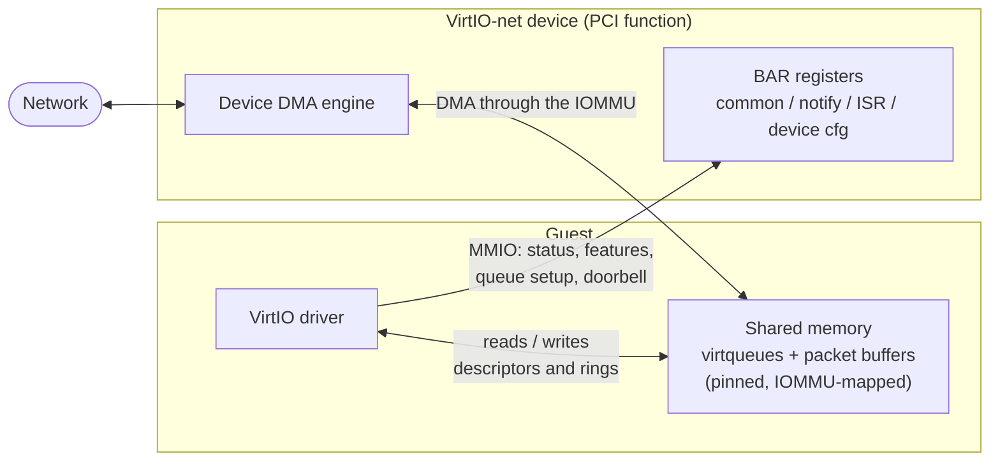
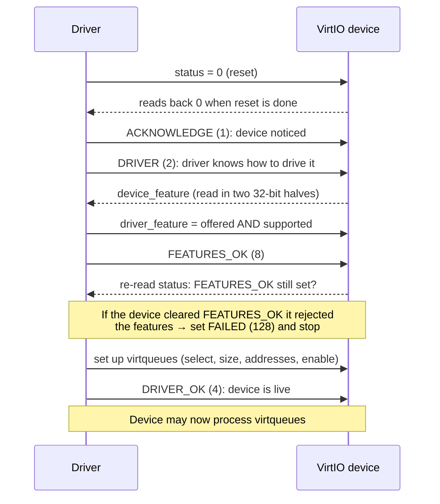
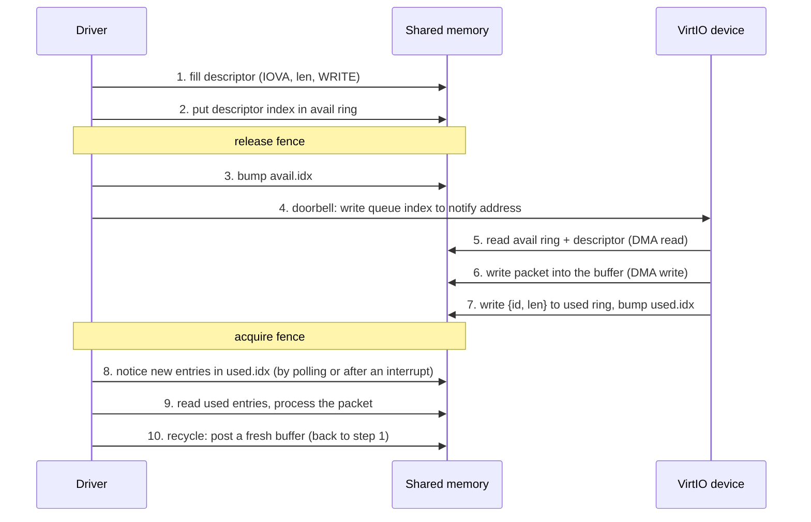

# VirtIO and virtio-net

## Introduction

VirtIO is a standard for **paravirtualized I/O devices**. A guest OS knows it is running in a VM and talks to a simple, well-defined device interface instead of emulating a real piece of hardware such as an Intel e1000 NIC. This makes I/O faster and the driver much simpler.

A VirtIO device has three parts:

- **Transport:** how the driver finds the device and reaches its registers. This page covers **VirtIO over PCI**; there are also MMIO and channel-I/O transports.
- **Device configuration and feature negotiation:** a status handshake and a feature bitmap, so driver and device agree on what is supported.
- **Virtqueues:** shared-memory queues used to move data.

This page summarizes the OASIS VirtIO 1.x specification, focusing on the PCI transport, split virtqueues and the network device.

## Where the Pieces Live

The driver and the device never call each other. They communicate through two channels:

1. **Registers (MMIO):** the driver writes to the device's BARs for configuration and to ring the doorbell.
2. **Shared memory (DMA):** the driver prepares queues and buffers in RAM, and the device reads and writes them with DMA.

In a virtualized setup the "device" is implemented by the hypervisor (e.g. QEMU) or by hardware, but the driver sees an ordinary PCI function either way.

## virtio over PCI

### Identification

- Vendor ID `0x1af4` (Red Hat / VirtIO).
- Modern (VirtIO 1.x) device IDs are `0x1040 + <device type>`; virtio-net is type 1, so **`0x1041`**.

### Capabilities and BARs

Rather than fixed register offsets, a modern device describes where its registers are using **vendor-specific PCI capabilities** (capability ID `0x09`) in configuration space. Each one names a BAR, an offset within it and a length:

| `cfg_type` | Structure | Purpose |
|---|---|---|
| 1 | Common configuration | Status, feature negotiation, per-queue setup |
| 2 | Notification | Doorbell area; has an extra `notify_off_multiplier` field |
| 3 | ISR status | Interrupt status for legacy INTx |
| 4 | Device-specific configuration | For virtio-net: MAC address, link status, … |
| 5 | PCI configuration access | Alternative window into the structures through config space |
| 8 | Shared memory | Optional shared regions (unused by virtio-net) |
| 9 | Vendor data | Vendor-specific (unused by virtio-net) |

The driver walks the capability list and resolves each entry to a location inside the corresponding BAR. The PCI configuration access capability (type 5) is only needed when a BAR cannot be mapped directly.

## Device Initialization

The driver and device walk through a fixed status handshake by setting bits in `device_status`:

Notes:

- **Feature negotiation:** the driver takes the intersection of what the device offers and what it supports. Two important bits are `VIRTIO_F_VERSION_1` (bit 32, the modern interface) and `VIRTIO_F_ACCESS_PLATFORM` (bit 33).
- **`VIRTIO_F_ACCESS_PLATFORM`** tells the device that the addresses the driver gives it are *bus/IOVA* addresses that go through the platform's IOMMU, not raw guest-physical addresses.
- Virtqueues must be fully configured **before** `DRIVER_OK`; after that the device is allowed to use them.
- The numeric status values are `ACKNOWLEDGE=1`, `DRIVER=2`, `DRIVER_OK=4`, `FEATURES_OK=8`, `DEVICE_NEEDS_RESET=64`, `FAILED=128`.

## Virtqueues

A virtqueue is the data channel between driver and device. virtio-net uses one RX and one TX queue per queue pair.

The **split virtqueue** layout consists of three structures in driver-allocated memory:

| Structure | Written by | Contents |
|---|---|---|
| **Descriptor table** | Driver | `queue_size` entries of `{addr, len, flags, next}`; each describes one buffer |
| **Available ring** (`avail`) | Driver | A `flags`/`idx` header followed by a ring of descriptor indices the device may use |
| **Used ring** (`used`) | Device | A `flags`/`idx` header followed by a ring of `{id, len}` entries for buffers the device finished with |

Key details:

- `addr` in a descriptor is the buffer's **IOVA**, the address the *device* must use, not a CPU virtual address.
- Descriptor flags: `NEXT` (chain continues at `next`), `WRITE` (the *device* writes to this buffer, as for RX), `INDIRECT`.
- `avail.idx` and `used.idx` are **free-running 16-bit counters** that wrap at 2^16; the ring slot is `idx % queue_size`. Driver and device each track how far they have consumed.
- `used.len` is the number of bytes the device actually wrote into the chain.

The three addresses are given to the device through `queue_desc`, `queue_driver` (avail) and `queue_device` (used); then `queue_enable = 1`.

### Buffer lifecycle

The ordering matters. The driver must make descriptors and ring entries visible **before** it updates `avail.idx`, and `avail.idx` before the doorbell; it must read `used.idx` **before** reading the used entries. Release/acquire memory barriers provide this ordering.

## DMA in VirtIO

Every arrow between the device and "shared memory" in the diagrams above is a **PCIe DMA** (first-party bus mastering, as described in [dma.md](dma.md)):

- **Device DMA reads:** the available ring and descriptors, and TX packet data.
- **Device DMA writes:** RX packet data and used-ring entries.
- **Driver MMIO writes:** doorbells and configuration, which are *not* DMA; the CPU writes to the device's BAR.

Requirements this places on the driver:

- All queue and buffer memory must be **pinned**, so it cannot be swapped or moved, and **DMA-mapped** so that the IOMMU lets the device reach it.
- The addresses written into descriptors and `queue_*` registers must be the **IOVAs** the device sees.
- With the IOMMU the device can reach *only* memory that was explicitly mapped for it, which is the protection described in [PCIe/pcie-dma-data-path.md](PCIe/pcie-dma-data-path.md).

## Notifications

Two directions of signalling exist:

- **Driver → device ("kick"):** the driver writes the queue index to the queue's notification address, computed as
  `notify_base + queue_notify_off * notify_off_multiplier`.
  This is an MMIO write that the Root Complex forwards to the device.
- **Device → driver (interrupt):** the device can raise MSI-X (or INTx, reported through the ISR register) after updating the used ring.

Either side can ask the other to hold back using the `flags` fields of the rings. A driver may also skip interrupts entirely and **poll** `used.idx` in a busy loop, which trades CPU for latency.

## virtio-net

### Packet header

Every packet buffer starts with a `virtio_net_hdr`. For VirtIO 1.x it is 12 bytes:

| Field | Size | Purpose |
|---|---|---|
| `flags` | 1 | e.g. checksum needed / data valid |
| `gso_type` | 1 | Segmentation offload type |
| `hdr_len` | 2 | Length of the headers (for offloads) |
| `gso_size` | 2 | Segment size for offloads |
| `csum_start`, `csum_offset` | 2 + 2 | Where checksum starts, and where to store it |
| `num_buffers` | 2 | Number of buffers used (merged RX buffers) |

The header sits immediately before the Ethernet frame in the same buffer. The offload-related fields are meaningful only if the matching offload features were negotiated.

### Receive path

The receive queue works in the opposite direction from what one might expect: the driver supplies *empty* buffers in advance, and the device fills them as packets arrive.

1. **Buffers offered:** the driver places empty, device-writable (`WRITE`) buffers in the RX queue's avail ring. Each buffer must be large enough for `virtio_net_hdr` plus a frame.
2. **Packet arrives:** the device takes a buffer from the avail ring and DMA-writes `virtio_net_hdr` followed by the Ethernet frame into it.
3. **Completion:** the device publishes `{id, len}` in the used ring, where `len` covers the header and the frame, and optionally interrupts the driver.
4. **Replenishing:** a buffer returned in the used ring is no longer available to the device, so the driver must offer new buffers to keep receiving.

### Transmit path

The transmit queue is the mirror image: the driver places buffers that contain `virtio_net_hdr` followed by the frame in the avail ring (read-only for the device), notifies the device, and the device reads them with DMA and returns them in the used ring once sent.

## References

- OASIS, *Virtual I/O Device (VIRTIO) Specification*, version 1.x: sections on PCI transport, split virtqueues and network device.